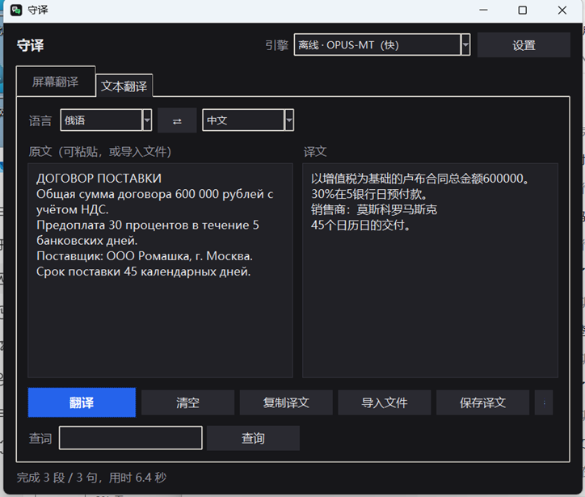

# 守译 · RuZh

**中俄双语**的桌面翻译工具：屏幕、Word、Excel、PDF、图片，五条路都是同一套
离线识别 + 术语库。全部在本机跑，一个字不外发。

框选屏幕上一块区域（视频字幕、外文界面、软件界面），程序持续截屏 →
**离线 OCR** → **翻译** → 在原文位置叠加显示译文。



*上面这张是**本地大模型**（Qwen2.5-1.5B，跑在 llama.cpp 上，不联网、不填 key）的真实输出。
四行全对：增值税、预付款、交货期、日历日。汇率和金额这类错不得的地方，提示词 + 词库双重管着：
原文出现 рубль 时，译文里绝不允许出现「人民币」。*

*嫌慢可以切「离线 · OPUS-MT」：一句 0.4–0.8 秒，但译文是词快（「买方方」「预付款款」那类），
适合看大意，不适合发给客户。两个都在本机跑，屏幕内容都不出机器。*

翻文件也一样：`翻译文档…` 出 Word/Excel 新文件（排版不动），
`翻译 PDF…` 逐页判断走文字层还是识别，`翻译图片…` 认照片和截图。
四种入口共用同一个 OCR 引擎、同一份术语库、同一套数字保护。

**翻译层是模型无关的**：内置离线模型和在线服务都只是"引擎"之一，
你也可以把自己写的引擎丢进一个文件夹里接上，或者直接指向任意一个
OpenAI 兼容的接口（DeepSeek / Moonshot / 本地 Ollama、LM Studio、vLLM 都行）。
另有一个**术语表**，可以强制指定人名、专业词、行业术语的译法 —— 一个品名译错，
在贸易单据里是事故，不是读着别扭。

---

## English

**RuZh** is a Chinese↔Russian translator for the desktop. Same idea, five surfaces:
translate a **region of the screen** in place, or whole **Word / Excel / PDF / image**
files, all through one offline OCR engine and one glossary.

- **Nothing leaves the machine** by default. The offline path is a local ONNX model;
  bringing your own OpenAI-compatible endpoint is opt-in.
- **Your terms stay your terms.** A glossary rule can pin a product name, a city or a
  standard (ГОСТ, ПЭТ) so it comes out the same way every time.
- **Numbers are protected.** Amounts and quantities are replaced with placeholders
  before translation and restored after; a lost one is reported in red, because a
  quotation with a wrong amount is worse than no quotation.
- **Every page decides for itself.** A PDF whose first page is digital and second is a
  scan is read the right way on each page.

Windows, Python 3.10+, no cloud account needed:

```bash
pip install -r requirements.txt
python scripts/setup_models.py     # ~690 MB of offline models, resumable
python main.py
```

Licence: MIT for the code. The bundled Chinese-Russian dictionary is CC BY-SA 3.0 and
the bundled Cyrillic OCR model is Apache-2.0 — see [app/data/README.md](app/data/README.md).

"RuZh" is the repo name (ru → zh); 守译 is what it is called in Chinese.

---

## 目录

- [它能做什么](#它能做什么)
- [快速开始](#快速开始)
- [翻译引擎](#翻译引擎)
- [自己写一个引擎](#自己写一个引擎)
- [术语表（词库）](#术语表词库)
- [界面与热键](#界面与热键)
- [工程笔记：几个不好踩的坑](#工程笔记几个不好踩的坑)
- [目录结构](#目录结构)
- [开发](#开发)
- [常见问题](#常见问题)
- [许可与致谢](#许可与致谢)

---

## 它能做什么

| | |
|---|---|
| **框选即用** | 拖一个框，只翻译那一块。范围越贴合文字，识别越快越准 |
| **悬浮字幕** | 译文直接盖在原文上；窗口对截屏**隐身**，不会把自己的译文再翻一遍 |
| **鼠标穿透** | 字幕窗不挡点击，可以边看视频边操作下面的窗口 |
| **全局热键** | `F8` 框选、`F9` 开始、`F10` 停止，在任何程序里都有效 |
| **防抖去重** | 字幕逐字浮现时等成型再翻；识别抖动不重复翻译 |
| **模型无关** | 离线模型 / 在线服务 / 你的插件 / 任意 OpenAI 兼容接口 |
| **术语表** | 人名、专业词强制译法，支持正则和分语言对生效 |
| **翻 PDF** | 逐页判断：有文字层的直接读（精确），扫描页渲染成图再识别。混装文件也能翻 |
| **翻图片** | 合同照片、微信截图直接选图就翻，不用先打字 |
| **翻文档** | Word / Excel 整份翻，排版、表格、公式、数字格式全保留 |
| **数字保护** | 金额数量在翻译前换成占位符，翻完换回来；丢了会红字提醒 |
| **脱敏** | 用联网或大模型时，公司名、税号、银行账号先换成占位符再发出 |

---

## 快速开始

**从源码跑**（需要 Python 3.10+）：

```bash
pip install -r requirements.txt
python scripts/setup_models.py     # 一次性：下 690 MB 离线模型，可断点续传
python main.py
```

`setup_models.py` 会先检查西里尔识别模型（8.6 MB，已随包提供）在不在，
再下翻译模型。`--check` 只检查不下载。它结束时会自己验一遍，
"下完了" 和 "能跑了" 不是一回事。

**Windows 打包版**（自带 Python，不用装任何东西）：

```bat
install.bat           :: 一次性：找（或自动下载安装）Python、建环境、装依赖
启动.bat              :: 运行；出问题用 启动-调试.bat 看报错
```

`install.bat` 不需要管理员权限。如果机器上没有任何 Python，它会从 python.org
下载并按当前用户静默安装。

跑起来之后：

1. 点 **① 框选区域**（或按 `F8`），拖住字幕所在的范围
2. 选 **② 语言**
3. 点 **▶ 开始翻译**（或按 `F9`）

在线引擎开箱即用。想用离线引擎：选「离线 · 本地大模型」（客户版已自带模型，无需下载），
或者选「离线 · OPUS-MT」再点「下载模型」
（约 170 MB／语言对）。

---

## 翻译引擎

主界面「翻译引擎」下拉框里切换，引擎按来源分四类：

| 引擎 | 联网 | 说明 |
|---|---|---|
| **联网 · MyMemory** | ✅ 默认 | 免费无需密钥，中/英/俄六向全通；匿名每日额度只有几千字符 |
| **联网 · 有道** | ✅ | 免费无需密钥，英↔中约 0.2–0.5 秒；非官方接口，限流较快 |
| **联网 · 百度翻译** | ✅ | 官方接口，最稳、额度最大（标准版每月免费 5 万字符），需 appid + 密钥 |
| **联网 · 自定义大模型** | ✅ | 任意 OpenAI 兼容接口，填地址 + 模型名即可 |
| **离线 · 本地大模型** | ❌ | 完全离线，Qwen2.5-1.5B 跑在 llama.cpp 上；译文可直接发客户，每句约 3–6 秒，占约 1 GB 内存 |
| **离线 · OPUS-MT** | ❌ | 完全离线，屏幕内容不出本机；每句约 0.4–0.8 秒，但只适合看大意 |
| **离线 · NLLB-200** | ❌ | 中文↔俄语可直译但极慢（每句 10–45 秒、额外约 2 GB 内存），默认不装 |
| **你自己的插件** | 看你 | 见下一节 |

### ⚠️ 联网意味着什么

选联网引擎时，**识别到的文字会发送给第三方**。画面里有聊天记录、文档、
账号密码之类的隐私内容时，请切到任意一个「离线」引擎——那种模式下屏幕内容
完全不出本机。切到联网引擎时程序会弹窗提醒一次。

### 实测延迟与质量（同一批句子，本机 CPU）

| 原文 | 离线 OPUS-MT | 联网 |
|---|---|---|
| `I've been waiting for this moment my whole life.` | `我一直在等待这个时刻我的一生。` ❌ 跑飞 | `我一生都在等待这一刻。` ✅ |
| `The quick brown fox jumps over the lazy dog.` | `棕色狐狸跳过懒狗` | `敏捷的棕色狐狸跳过了懒狗。` ✅ |
| `Встреча перенесена на три часа дня завтра.`（俄→中） | `会议推迟到明天三点举行`（经英语中转） | `会议已推迟到明天下午三点。` 直译 ✅ |

| 引擎 | 每句耗时 | 俄→中是否能直接用 |
|---|---|---|
| 离线 · 本地大模型（Qwen2.5-1.5B） | 3–6 s | ✅ 直译，合同句可以直接发客户 |
| 离线 OPUS-MT（直连） | 0.4–0.8 s | — |
| 离线 OPUS-MT（俄↔中转） | 1.5–2.6 s | ❌ 词快，只适合看大意 |
| 联网 MyMemory | 0.9–2.6 s | ✅ |
| 联网 有道 | 0.2–0.5 s | ✅ |

同一批合同句，两条离线路线的差距（实测）：

| 原文 | 本地大模型 | OPUS-MT 两跳 |
|---|---|---|
| Предоплата 30 процентов в течение 5 банковских дней. | 预付款为合同金额的30%，在5个银行工作日内支付。 ✅ | 在5银行日预付款了1%的预付款款。 ❌ |
| В случае просрочки поставки поставщик уплачивает неустойку. | 如供货延迟，供货方需支付违约金。 ✅ | 如果交货迟缓，供应商应支付罚款。 △ |
| Срок поставки 45 календарных дней. | 交货期 45 日历日 ✅ | 自付款之日起45个日历日的交付日期。 △ |

**为什么 OPUS 这条路只能中转**：Helsinki-NLP 从未发布 `ru↔zh` 模型
（`opus-mt-ru-zh` / `opus-mt-zh-ru` 都是 404），所以它只能 `ru → en → zh` 翻两遍，
误差在两段之间累加。**本地大模型没有这个问题** —— Qwen2.5 本身认得俄语和中文，
给它一句俄语直接要中文，不需要中转。这也是它更慢但好得多的原因。

---

## 自己写一个引擎

把任意 `.py` 丢进项目根目录的 `engines_custom/`，重启程序（或点「重新扫描插件」），
它就会出现在引擎下拉框里。这个目录**故意放在 `app` 包外面**，所以升级程序
不会覆盖你写的东西。

```python
NAME = "my-engine"        # 唯一 id（不填就用文件名）
LABEL = "我的引擎"         # 下拉框里显示的名字
HINT = "接我自己的模型"     # 下拉框下面那行说明
LANGUAGES = ["en", "zh"]  # 可选；不填表示所有语言对都接

def create(cfg, models_root):
    return MyTranslator()  # 需要有 translate(text) -> str
```

翻译器对象只需要一个方法，其余都可选：

```python
def translate(self, text: str) -> str   # 必需
def load(self)                          # 可选：加载模型、建连接
def set_beams(self, n)                  # 可选：不适用就忽略
def describe(self) -> str               # 可选：调试信息
```

`create()` 抛异常**不会让程序崩溃** —— 界面会把原因显示在「引擎与词库」页。
目录里自动生成的 `README.md` 和 `_example_dictionary.py` 有完整说明。

### 不想写代码？

用「联网 · 自定义大模型」：填一个 OpenAI 兼容的接口地址和模型名即可。

```
接口地址  http://127.0.0.1:11434/v1        # 本地 Ollama
模型名    qwen2.5:7b
API Key   （本地服务留空）
```

也支持 DeepSeek、Moonshot、one-api 网关等任何实现了
`POST {base}/chat/completions` 的服务。翻译用的提示词可以在配置里改。

---

## 术语表（词库）

机器翻译不认识人名、游戏道具、专业术语，术语表就是补这个的。
在「引擎与词库」页可以直接添加，也可以直接编辑 `glossary.json`：

```json
{
  "version": 1,
  "rules": [
    {"src": "GPU",  "dst": "显卡",  "case_sensitive": false},
    {"src": "\\bAI\\b", "dst": "人工智能", "mode": "regex"},
    {"src": "Kubernates", "dst": "Kubernetes", "side": "source"},
    {"src": "Zhihu", "dst": "知乎", "pairs": ["en->zh"]}
  ]
}
```

| 字段 | 说明 |
| --- | --- |
| `src` / `dst` | 原文 / 译文 |
| `mode` | `literal`（默认）或 `regex` |
| `side` | `target`（默认，替换译文）或 `source`（翻译前改写识别结果） |
| `case_sensitive` | 默认 `true` |
| `pairs` | 限定语言对，如 `["en->zh"]`；不填表示全部 |
| `enabled` | 临时停用某条规则 |

- **译文侧**（默认）用于修正译名：`GPU` → `显卡`
- **原文侧**用于帮弱模型一把：把拼写错误或缩写换成模型认识的形式
- 支持 **TSV 导入导出**，方便在 Excel 里维护（菜单里的「导入 TSV / 导出 TSV」）
- 词库文件改动后**下一帧自动生效**，不用重启

---

## 界面与热键

| 区域 | 说明 |
| --- | --- |
| ① 框选区域 | 拖拽选择要翻译的范围 |
| ② 语言 / 翻译引擎 | 中/英/俄在前，日/韩/法/德/西可选 |
| ③ 刷新间隔 | 多久截一次屏。300 ms 最灵敏，1500 ms 以上更省 CPU |
| 引擎与词库 | 插件、自定义大模型、百度密钥、术语表 |
| 字幕显示 | 悬浮窗位置、字号、不透明度、是否显示原文、鼠标穿透 |
| 高级 | 识别置信度、识别分辨率、稳定帧数、翻译质量 |
| 日志 | 运行状态与错误信息，排错先看这里 |

| 热键 | 作用 |
| --- | --- |
| `F8` | 框选区域 |
| `F9` | 开始翻译 |
| `F10` | 停止 |

热键被占用时会在日志里提示，可在 `config.json` 的 `hotkeys` 里改。

---

## 工程笔记：几个不好踩的坑

这些都是实测踩出来的，记下来免得重踩。

**1. 悬浮窗会把自己翻译一遍。**
覆盖模式下译文盖在原文上，下一帧截屏又把自己的译文读回去，无限循环。
解法是 `SetWindowDisplayAffinity(WDA_EXCLUDEFROMCAPTURE)`：窗口在屏幕上可见，
但对截屏 API 隐身。程序做了对照测试验证这一点。

**2. RapidOCR 默认会把小图放大 6 倍。**
它的检测器默认 `limit_type=min, limit_side_len=736`，对细长字幕条会把短边
放大到 736，慢得离谱。改成 `limit_type=max` 后快了一个数量级；方向分类器
对屏幕文字没用，也关掉了。

**3. 束搜索在短句上会跑飞。**
模型自己的配置写着 `num_beams=4`，但实测 15 句字幕风格的句子后放弃了：
慢 33%，而且偶尔生成多余的尾巴
（`I've been waiting for this moment my whole life.` →
`我一直在等待这个时刻我的一生。`）。现在默认贪心，束搜索作为选项保留。

**4. 相似度比值在短句上不可靠。**
`Hello world.` → `Hello world,` 只错一个字符，相似度就掉到 0.92，
低于任何合理阈值。改成按**字符差异数**容忍。

**5. Windows 扩展模块只在自己目录里找依赖。**
系统缺 VC++ 运行库时，只把 `msvcp140.dll` 放到解释器目录还不够 ——
onnxruntime 的 `.pyd` 加载时只在 `onnxruntime\capi\` 下找，
`msvcp140_1.dll` 也必须放进那里。

**6. ICO 里的小尺寸必须是 BMP，不能是 PNG。**
Pillow 的 ICO 写入器默认把所有尺寸都存成 PNG 载荷，而规范里只有 256×256
允许 PNG。Explorer 因此拒绝整个文件、显示成通用白纸图标 ——
但 `DrawIconEx` 和 `SHGetFileInfo` 走的是更宽容的加载路径，**照样画得出正确图标**，
所以光靠 API 验证会得出错误结论。`scripts/make_icon.py` 现在手写 ICO 结构并自校验。

**7. Python 3.12 的 venv 不可搬运。**
`pyvenv.cfg` 写死了基础解释器的绝对路径，`Lib` 里也没有标准库。
把项目拷到别的电脑时必须重建环境；`scripts/setup_env.py` 会检测
"看起来存在但其实不可用"的 venv 并重建。

**8. Windows PowerShell 5.1 会吃掉传给原生程序的参数里的双引号。**
`python -c 'print("%d" % 1)'` 会变成 `print(%d % 1)`，直接语法错误。
含引号的代码一律写成临时文件再执行。

---

## 目录结构

```
.
├─ main.py                     入口（先做启动引导，再开界面）
├─ 启动.bat / 启动-调试.bat      运行
├─ install.bat                 一次性安装
├─ requirements.txt
├─ config.json                 运行后生成（已在 .gitignore 中）
├─ glossary.json               术语表（运行后生成）
├─ assets/app.ico              应用图标
├─ engines_custom/             用户插件目录（含 README 与示例）
├─ app/
│  ├─ bootstrap.py             DPI 感知 + VC++ 运行库修复 + 离线环境变量
│  ├─ config.py                配置模型与读写
│  ├─ capture.py               区域截屏（mss）
│  ├─ ocr_engine.py            离线 OCR（RapidOCR / PP-OCRv4）
│  ├─ glossary.py              术语表：规则、正则、TSV 互转
│  ├─ translator.py            Marian / NLLB 解码实现
│  ├─ online.py                内置在线服务提供方
│  ├─ engine.py                引擎门面（转发到 app/engines）
│  ├─ engines/
│  │  ├─ base.py               引擎协议 + 插件适配器
│  │  ├─ builtin.py            内置引擎（离线 + 在线）
│  │  ├─ custom.py             插件发现与加载
│  │  └─ http_engine.py        OpenAI 兼容接口引擎
│  ├─ pipeline.py              后台流水线：截屏→识别→词库→翻译→去抖
│  ├─ region_picker.py         全屏框选
│  ├─ overlay.py               悬浮字幕窗（防截屏回环、鼠标穿透）
│  ├─ hotkeys.py               全局热键
│  ├─ models.py                模型文件注册表
│  ├─ downloader.py            断点续传 + 分片下载
│  └─ ui.py                    Tkinter 主界面
├─ scripts/
│  ├─ bootstrap.ps1            找/装 Python（注意：必须 UTF-8 with BOM）
│  ├─ setup_env.py             建 venv、装依赖、部署运行库
│  ├─ download_models.py       下载离线模型
│  ├─ make_icon.py             生成 assets/app.ico
│  ├─ install_shortcut.py      部署图标 + 建桌面快捷方式
│  └─ doctor.py                环境自检
└─ tests/                      回归与评测脚本（见下）
```

---

## 开发

```bat
python scripts\doctor.py                      :: 环境自检（含联网引擎实测）
python scripts\doctor.py --capture            :: 顺带截取已保存的区域并识别
.venv\Scripts\python.exe tests\test_logic.py          :: 去抖/词库等纯逻辑
.venv\Scripts\python.exe tests\test_glossary_plugin.py :: 术语表与插件加载
.venv\Scripts\python.exe tests\test_online_engine.py   :: 引擎集成（会联网）
.venv\Scripts\python.exe tests\test_e2e.py             :: 真实截屏→OCR→翻译→悬浮窗
.venv\Scripts\python.exe tests\eval_quality.py         :: 翻译质量与延迟评测
```

几个测试值得说明：

- `test_e2e.py` 会真的开一个窗口、截屏、识别、翻译、显示悬浮窗，
  并验证**悬浮窗没有出现在截图里**（用唯一哨兵串判断，而不是"出现中文就算泄漏"
  —— 屏幕上本来就可能合法地有中文）
- `test_online_engine.py` 会真的调用在线接口，消耗少量免费额度
- `tests/check_icon.py` 可以问 Windows Shell 它给某个快捷方式解析出哪个图标

---

## 发布到代码托管

仓库本身不需要装 git —— 本机就是在没有 git 的情况下建起来的，
用的是纯 Python 的 [dulwich](https://www.dulwich.io/)。

```bat
:: 1. 建仓并首次提交（已建过则变成"提交改动"）
python scripts\init_repo.py
python scripts\init_repo.py --message "修了框选偏移"

:: 2. 看会收录哪些文件，先确认没有大文件混进去
python scripts\init_repo.py --dry-run
```

推送：

```bat
:: 先在网页上建一个空仓库（不要勾选自动生成 README）
set GIT_REMOTE=https://gitee.com/你的用户名/仓库名.git
set GIT_TOKEN=你的私人令牌

python scripts\publish.py --check     :: 只测 git 端点通不通
python scripts\publish.py             :: 推送 main
```

令牌从哪来：

- **Gitee**：设置 → 私人令牌 → 生成新令牌（勾选 `projects` 权限）
- **GitHub**：Settings → Developer settings → Personal access tokens

**别把令牌写进文件** —— 只从环境变量或命令行传，否则它会跟着提交一起被推上去。

`publish.py` 在推送前会自动跑一遍 `scripts/check_secrets.py`，检查
**已提交 + 准备提交**的文件里有没有密码、令牌、密钥、Cookie 文件、绝对路径或邮箱。
有命中就拒绝推送（确认无误可以 `--skip-scan`）。单独运行：

```bat
python scripts\check_secrets.py
```

`scripts/publish.py --show-hosts` 会列出各家的地址格式。本机实测（2026-10）：
gitee / gitcode / codeberg 正常；**github.com 的 git 端点返回 401（说明通、只是要认证），
但 curl 的 GET 会超时**，大流量传输可能被限速掐断 —— 可以试，失败就换 Gitee。

> 之所以用白名单而不是黑名单挑文件（见 `scripts/init_repo.py` 的 `INCLUDE_DIRS`）：
> 工作目录里常常还躺着别的东西（另一个项目的文件夹、工具产物），
> 黑名单总会漏，白名单不会。`.venv/`（约 350 MB）和 `models/`（约 700 MB）也已排除。

---

## 常见问题

**提示 `DLL load failed` / 导入 onnxruntime 失败**
系统缺少 VC++ 运行库。`install.bat` 会把 `msvc-runtime` 提供的 DLL 复制到
`onnxruntime\capi\` 下解决。仍失败就跑 `python scripts\doctor.py`。

**模型下载慢或中断**
默认走 `hf-mirror.com`，支持断点续传与多线程分片，中断后重跑会接着下。
可以换镜像或线程数：
```bat
python scripts\download_models.py en-zh --mirror https://hf-mirror.com --connections 8
```

**多显示器 / 高 DPI 下框选位置不对**
程序启动时申请 per-monitor DPI awareness。显示器分辨率变化后重新框选一次。

**全屏游戏截不到画面**
独占全屏（exclusive fullscreen）通常截不到，改成窗口或无边框窗口模式。

**识别不出文字**
先看日志里 OCR 有没有返回内容；把框选范围收紧到文字本身、避开半透明背景；
也可以调低「识别置信度下限」、调高「识别分辨率上限」。

**联网引擎报额度用尽 / 411**
MyMemory 匿名额度只有几千字符/天，有道限流也很快。长时间看字幕请用
「联网 · 百度」（[申请地址](https://fanyi-api.baidu.com/)，标准版每月免费 5 万字符）。

---

## 许可与致谢

本项目的代码以 **MIT** 许可发布，见 [LICENSE](LICENSE)。

软件**不包含翻译模型**（由 `setup_models.py` 下载），但**包含**两个数据类资产：
随包的俄文识别模型，以及 156,590 条的离线中俄词典。后者是 CC BY-SA 3.0，
署名与同方式共享的要求写在 [app/data/README.md](app/data/README.md)。
第三方组件的许可如下，商业使用前请自行确认：

| 组件 | 许可 |
| --- | --- |
| Helsinki-NLP OPUS-MT 模型（部分语言对） | Apache-2.0 |
| Helsinki-NLP OPUS-MT 模型（部分语言对） | CC-BY-4.0（**需署名**） |
| NLLB-200（默认不安装） | CC-BY-NC-4.0（**禁止商用**） |
| RapidOCR / PP-OCRv4 | Apache-2.0 |
| PaddleOCR cyrillic_PP-OCRv3_rec（随包提供的俄文识别模型） | Apache-2.0 |
| FreeDict / WikDict 中俄词典（app/data/zh_ru_dict.db） | **CC BY-SA 3.0（需署名，数据部分同方式共享）** |
| pypdfium2（PDF 读取与渲染） | BSD-3-Clause / Apache-2.0 |
| onnxruntime | MIT |
| transformers | Apache-2.0 |
| Pillow / opencv-python / numpy / mss | MIT / Apache-2.0 / BSD |

**俄语↔中文的离线路线**经过英语中转，链路上包含 CC-BY-4.0 的 `opus-mt-ru-en`，
商业使用时请署名。联网引擎的条款见各服务商。

感谢 Helsinki-NLP、Xenova（ONNX 导出）、RapidOCR、PaddleOCR 与
ONNX Runtime 的作者们 —— 这个工具几乎全部建立在他们的工作之上。